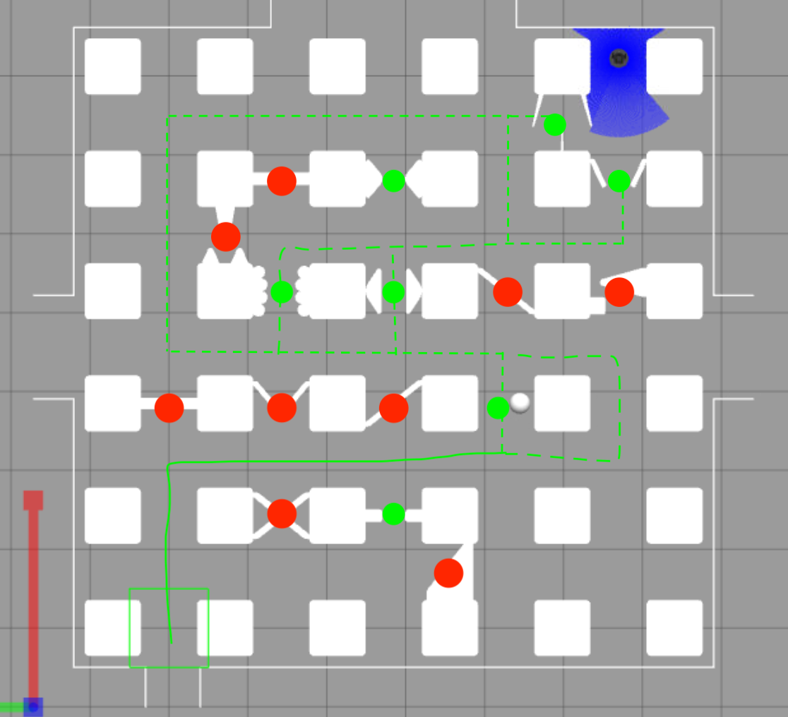

# Edge Passability Ground-Truth Survey

**Documentation:** [README](../README.md) · [Setup](setup.md) · [Framework](framework.md) · [Methodology](methodology.md) · [Perception strategy](perception-strategy.md) · [Perception API](perception-api.md) · [Task ownership](tasks.md) · [Development plan](development.md) · **Ground-truth survey** · [Controller debug](controller-debug.md) · [Navigator tests](testing.md) · [Offline tests](navigation-offline-tests.md) · [RViz & debugging](debugging.md)

---

**Purpose:** Maintain the team's current classification of **all 40 undirected graph edges** in the obstacle-containing world. The annotation is the team's stated ground-truth reference for evaluating perception, not an obstacle map to embed in the submitted navigator.

## Current annotated ground truth



The team uses **three descriptive categories**:

- **`P-clear`** — no obstacle between the adjacent graph nodes (unmarked edges); passable.
- **`P-constrained`** — green dot: obstacles or a narrow opening are present, but the edge is considered passable with suitable steering.
- **`B`** — red dot: the edge is considered blocked.

For `is_passable()` ground-truth comparison, both passable categories map to **`True`**, while `B` maps to **`False`**. **No edges are currently classified as unknown.** The colors and the 40-edge table below represent the user's survey annotations, not independently verified no-contact robot trials. Confidence and trial evidence may be added later without changing the present classification.

**Inventory summary:** 24 `P-clear`, 7 `P-constrained`, 9 `B` (40 total). Edge IDs use `Hrc` for an edge from row `r`, column `c` to column `c+1`, and `Vrc` for row `r` to row `r+1` at column `c`. All remaining edges not specifically annotated green/red are `P-clear`.

The maze-specific classifications **must not be hard-coded into `navigator.py`**. A route's physical passability is also distinct from whether the current controller succeeds in traversing it. Keep measured gap widths and short-horizon safety predictions separate from these labels.

## 1. Prepare the environment

1. Follow the [repository environment setup](setup.md) to install the **already-extracted** models from this repository, configure `GAZEBO_MODEL_PATH`, and build/source the included `vmc2_project` package. Use the **obstacle-containing** world for ground-truth classification; the obstacle-free model is only for checking sensing and manual control.
2. Launch the simulation from a terminal with the workspace and model paths configured:

   ```bash
   ros2 launch vmc2_project project.launch.py
   ```

3. **Ensure `navigator.py` is not publishing commands** during teleoperation. The unfinished template can also fail if run as-is; inspect the launch configuration and disable the navigator node if it launches automatically. Keep Gazebo and the robot sensor publishers running. Do not run two `/cmd_vel` controllers at once.
4. In another sourced terminal, confirm interfaces and start manual control (if the package is installed):

   ```bash
   ros2 topic list
   ros2 topic info /scan
   ros2 topic info /odom
   ros2 topic info /cmd_vel
   ros2 run turtlebot3_teleop teleop_keyboard
   ```

   If teleop is unavailable, install/use a compatible ROS 2 keyboard teleop. Begin at low speed; manual teleop does not provide automatic collision prevention.
5. Start `rviz2`. Use the `odom` fixed frame **if TF supports it**. Add LaserScan (`/scan`), Odometry (`/odom`), TF (`/tf`), and a Grid. Inspect `header.frame_id` in `/scan` and `/odom` and resolve transform errors before relying on overlays. The provided `draw_scene()` is OpenCV-based and does **not** publish RViz markers.
6. For repeatable measurements, keep the world configuration, robot footprint assumptions, speed limits, and sensor settings consistent. Use **simulation time** when comparing timestamps.

## 2. Test a particular edge

**At each edge:**

1. Stop all motion and stop the navigator before teleporting (as required by the assignment).
2. Teleport the robot to node **A**, oriented toward **B**. Use the script below; it supplies a valid quaternion for east/west/north/south.
3. Wait for odometry and `/scan` to settle. Confirm the robot is at the intended node, pointing along the edge. Be alert to collisions immediately after teleporting; node-center clearance itself must be checked.
4. In RViz, first assess the obstacle geometry **without moving**. Note any visible gap, occluded space, and suspected bottleneck. Save a screenshot or bag recording.
5. Drive slowly toward B, steering around obstacles if a collision-free corridor is visible. Stop with room to brake; **never use contact as the method to discover width**. Record whether the robot center reaches B within the navigation node's typical `node_tol = 0.05 m`, where practical.
6. If the edge is ambiguous, try another approach or observation pose, optionally repeat from B toward A. Do not mark an edge blocked merely because a single scan lacks a gap or a teleop attempt failed.
7. Record label, direction tested, minimum *observed* clearance (if measured), margins, confidence, outcome, and evidence. Distinguish `unknown` from `occupied` regions when interpreting scans.
8. Return to a safe pose; teleport to the next edge start. Capture at least one recorded scan/observation from challenging edges.

### Reusable teleport helper

Create `teleport_edge.py` **locally** with the following content. It prints a ROS 2 service call for any neighboring A → B edge; run the printed command in a ROS-sourced terminal. This avoids manually calculating quaternion signs.

```python
#!/usr/bin/env python3
import math
import shlex
import sys

X = [0.712, 2.136, 3.560, 4.984, 6.408]
Y = [0.0, -1.424, -2.848, -4.272, -5.696]

# usage: python3 teleport_edge.py start_row start_col end_row end_col
ra, ca, rb, cb = map(int, sys.argv[1:5])
assert all(0 <= v < 5 for v in (ra, ca, rb, cb))
assert abs(ra - rb) + abs(ca - cb) == 1, "Nodes must be neighbors"
xa, ya = X[ca], Y[ra]
xb, yb = X[cb], Y[rb]
yaw = math.atan2(yb - ya, xb - xa)
z, w = math.sin(yaw / 2), math.cos(yaw / 2)
payload = (
    "{state: {name: 'burger', pose: {position: "
    f"{{x: {xa:.3f}, y: {ya:.3f}, z: 0.0}}, orientation: "
    f"{{x: 0.0, y: 0.0, z: {z:.8f}, w: {w:.8f}}}}}, "
    "reference_frame: 'world'}}"
)
print("ros2 service call /set_entity_state "
      "gazebo_msgs/srv/SetEntityState " + shlex.quote(payload))
```

Example, for the final southbound challenge:

```bash
python3 teleport_edge.py 3 4 4 4
# Copy and run the printed ros2 service call.
```

**Note:** For manual driving, you do **not** need to change `self.start_pos`, because you are not running the navigator. If later running the navigator from a teleported start, the assignment requires setting `self.start_pos` to the same position. Teleporting to one node does not force A* to choose a particular next edge.

## 3. Capture evidence and observations

Open a separate sourced terminal to record each edge:

```bash
ros2 bag record -o bags/R0C0_to_R0C1 /scan /odom /tf /tf_static
```

Stop the recording after the trial, and use a **different output name for every run** (e.g., `R3C4_to_R4C4_trial1`). ROS bags enable later replay of identical input data. Be careful not to mix replayed and live publishers on the same topics.

During each run monitor:

| Tool/display | Check | Why it matters |
|---|---|---|
| RViz LaserScan `/scan` | Obstacle surfaces, occlusion, angular sparsity, disappearing returns | Whether a visible opening is actually supported by sensor evidence |
| RViz Odometry `/odom` and TF | Pose, heading, transforms, any sudden jumps | Whether observations from different positions can be aligned |
| Gazebo top/orthographic view | Actual robot body vs. obstacle geometry | Visual ground-truth support for clearance and collision assessment |
| `/cmd_vel` via `ros2 topic echo` or `rqt_plot` | Intended forward/turn speed, stopping | Distinguish controller/teleop limitations from geometry |
| Optional custom Marker/PointCloud2 display | Accumulated points, candidate route, closest clearance | **Not available in template**; only if a visualization node is added |

The LiDAR shows first returns, **not all surfaces behind them**. RViz LaserScan decay is a visual history, not a registered occupancy map. A physical gap measurement should be conservative and should state how it was obtained; report `not measured` if necessary. Be careful with contact: a trial with any touch is not a successful no-collision pass.

### Per-trial record template

```text
Edge ID:
Direction: A -> B / B -> A
World: obstacle-containing / obstacle-free
Start pose + heading:
Ground-truth label: P-clear / P-constrained / B
Trial outcome (independent of ground truth): success / stopped / contact / inconclusive
Confidence: high / medium / low
Outcome: traversed to node / stopped safely / collision / aborted
Obstacle geometry and available routes:
Estimated narrowest clearance (m): value + method / not measured
Unknown or occluded regions:
Number of attempts and opposite-direction results:
Relevant ROS bag, screenshot/video paths:
Notes (steering, sensor artifacts, possible false blockage):
```

## 4. Ground-truth inventory: all 40 edges

Node labels use `RrCc` (row increases southward; column increases eastward). The labels below are transcribed from the team annotation, with **unmarked edges explicitly treated as unobstructed and passable**. Trial confidence and evidence are intentionally separate from the classification; record later observations in the final column.

### Horizontal edges (20)

| ID | A (west) | B (east) | Label | Confidence | Evidence / observations |
|---|---|---|---|---|---|
| H00 | R0C0 (0.712, 0.000) | R0C1 (2.136, 0.000) | P-clear | — | Unmarked; no edge obstacle |
| H01 | R0C1 (2.136, 0.000) | R0C2 (3.560, 0.000) | P-clear | — | Unmarked; no edge obstacle |
| H02 | R0C2 (3.560, 0.000) | R0C3 (4.984, 0.000) | P-clear | — | Unmarked; no edge obstacle |
| H03 | R0C3 (4.984, 0.000) | R0C4 (6.408, 0.000) | P-constrained | — | Green annotation |
| H10 | R1C0 (0.712, -1.424) | R1C1 (2.136, -1.424) | B | — | Red annotation |
| H11 | R1C1 (2.136, -1.424) | R1C2 (3.560, -1.424) | P-clear | — | Unmarked; no edge obstacle |
| H12 | R1C2 (3.560, -1.424) | R1C3 (4.984, -1.424) | P-clear | — | Unmarked; no edge obstacle |
| H13 | R1C3 (4.984, -1.424) | R1C4 (6.408, -1.424) | P-clear | — | Unmarked; no edge obstacle |
| H20 | R2C0 (0.712, -2.848) | R2C1 (2.136, -2.848) | P-clear | — | Unmarked; no edge obstacle |
| H21 | R2C1 (2.136, -2.848) | R2C2 (3.560, -2.848) | P-clear | — | Unmarked; no edge obstacle |
| H22 | R2C2 (3.560, -2.848) | R2C3 (4.984, -2.848) | P-clear | — | Unmarked; no edge obstacle |
| H23 | R2C3 (4.984, -2.848) | R2C4 (6.408, -2.848) | P-clear | — | Unmarked; no edge obstacle |
| H30 | R3C0 (0.712, -4.272) | R3C1 (2.136, -4.272) | P-clear | — | Unmarked; no edge obstacle |
| H31 | R3C1 (2.136, -4.272) | R3C2 (3.560, -4.272) | P-clear | — | Unmarked; no edge obstacle |
| H32 | R3C2 (3.560, -4.272) | R3C3 (4.984, -4.272) | P-clear | — | Unmarked; no edge obstacle |
| H33 | R3C3 (4.984, -4.272) | R3C4 (6.408, -4.272) | P-clear | — | Unmarked; no edge obstacle |
| H40 | R4C0 (0.712, -5.696) | R4C1 (2.136, -5.696) | P-clear | — | Unmarked; no edge obstacle |
| H41 | R4C1 (2.136, -5.696) | R4C2 (3.560, -5.696) | P-clear | — | Unmarked; no edge obstacle |
| H42 | R4C2 (3.560, -5.696) | R4C3 (4.984, -5.696) | B | — | Red annotation |
| H43 | R4C3 (4.984, -5.696) | R4C4 (6.408, -5.696) | P-clear | — | Unmarked; no edge obstacle |

### Vertical edges (20)

| ID | A (north) | B (south) | Label | Confidence | Evidence / observations |
|---|---|---|---|---|---|
| V00 | R0C0 (0.712, 0.000) | R1C0 (0.712, -1.424) | P-clear | — | Unmarked; no edge obstacle |
| V01 | R0C1 (2.136, 0.000) | R1C1 (2.136, -1.424) | B | — | Red annotation |
| V02 | R0C2 (3.560, 0.000) | R1C2 (3.560, -1.424) | P-constrained | — | Green annotation |
| V03 | R0C3 (4.984, 0.000) | R1C3 (4.984, -1.424) | P-clear | — | Unmarked; no edge obstacle |
| V04 | R0C4 (6.408, 0.000) | R1C4 (6.408, -1.424) | P-constrained | — | Green annotation |
| V10 | R1C0 (0.712, -1.424) | R2C0 (0.712, -2.848) | P-clear | — | Unmarked; no edge obstacle |
| V11 | R1C1 (2.136, -1.424) | R2C1 (2.136, -2.848) | P-constrained | — | Green annotation |
| V12 | R1C2 (3.560, -1.424) | R2C2 (3.560, -2.848) | P-constrained | — | Green annotation |
| V13 | R1C3 (4.984, -1.424) | R2C3 (4.984, -2.848) | B | — | Red annotation |
| V14 | R1C4 (6.408, -1.424) | R2C4 (6.408, -2.848) | B | — | Red annotation |
| V20 | R2C0 (0.712, -2.848) | R3C0 (0.712, -4.272) | B | — | Red annotation |
| V21 | R2C1 (2.136, -2.848) | R3C1 (2.136, -4.272) | B | — | Red annotation |
| V22 | R2C2 (3.560, -2.848) | R3C2 (3.560, -4.272) | B | — | Red annotation |
| V23 | R2C3 (4.984, -2.848) | R3C3 (4.984, -4.272) | P-constrained | — | Green annotation |
| V24 | R2C4 (6.408, -2.848) | R3C4 (6.408, -4.272) | P-clear | — | Unmarked; no edge obstacle |
| V30 | R3C0 (0.712, -4.272) | R4C0 (0.712, -5.696) | P-clear | — | Unmarked; no edge obstacle |
| V31 | R3C1 (2.136, -4.272) | R4C1 (2.136, -5.696) | B | — | Red annotation |
| V32 | R3C2 (3.560, -4.272) | R4C2 (3.560, -5.696) | P-constrained | — | Green annotation |
| V33 | R3C3 (4.984, -4.272) | R4C3 (4.984, -5.696) | P-clear | — | Unmarked; no edge obstacle |
| V34 | R3C4 (6.408, -4.272) | R4C4 (6.408, -5.696) | P-clear | — | Unmarked; no edge obstacle |

## 5. Priority edges for clearance analysis

These four edges were identified by the team as good clearance tests, including the final southbound challenge. The current survey labels are recorded in the inventory above:

| Priority | Edge | Suggested teleport command | Initial heading |
|---|---|---|---|
| 1 | (3.560, −5.696) → (4.984, −5.696) | `python3 teleport_edge.py 4 2 4 3` | East / 0° |
| 2 | (4.984, −1.424) → (6.408, −1.424) | `python3 teleport_edge.py 1 3 1 4` | East / 0° |
| 3 | (4.984, −2.848) → (6.408, −2.848) | `python3 teleport_edge.py 2 3 2 4` | East / 0° |
| 4 | (6.408, −4.272) → (6.408, −5.696) | `python3 teleport_edge.py 3 4 4 4` | South / −90° |

Use these to refine the perception algorithm. All 40 edges already have survey labels; focus limited trial time on the constrained and blocked cases, while checking a few unobstructed edges for false positives.

## 6. Review and consolidate ground truth

Before using the resulting labels to evaluate `is_passable()`:

- For stronger validation, add contact-free traversal evidence to `P-clear` and `P-constrained` labels, ideally in both directions where useful.
- For stronger validation, add independent geometric or repeated observational evidence for `B` labels; a failed maneuver alone is not proof of blockage.
- Record conflicting evidence explicitly and re-examine that classification rather than silently changing the annotated ground truth.
- Separate **ground-truth labels** from the detector's predicted `True`/`False` values; then evaluate false positives/negatives against the current survey labels, clearly noting that labels have not all been validated by clean robot traversals.
- Remember the assignment prohibits hard-coding or prerecorded maze-specific knowledge **in the submitted navigator**. This survey is for testing, debugging, and algorithm validation, not to build a fixed blocked-edge lookup table into `navigator.py`.

**Current status:** All 40 graph edges have survey labels (31 passable, 9 blocked). Next, add controlled observations and trial evidence, particularly for constrained openings and blocked passages.

## Interpreting Stage 2 observations

Use the survey’s `P-clear`, `P-constrained`, and `B` labels as the current reference, while separately recording whether traversal observations support them. For future detector comparison, separately record the **minimum short-horizon clearance predicted for an obstacle-shifted lookahead**. An apparently safe short arc is not proof that the whole edge can be traversed; failing one local target also does not establish that the edge is blocked. The survey remains independent of the algorithm and must not become a prerecorded obstacle map.
