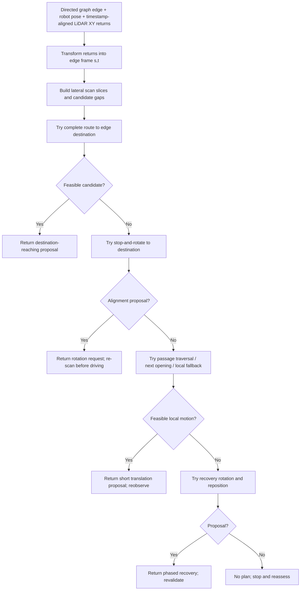

# Perception Module v1.1 — planning strategy

**Status:** This describes the implemented, standalone perception and trajectory planner (`vmc2_project/src/perception.py`). It is **not yet integrated** with `navigator.py`. Read this first for the **why and how**; see [the API reference](perception-api.md) for function contracts and [debugging](debugging.md) for visual diagnostics.

## The idea in one paragraph

**Prefer reaching the directed graph edge's destination, but use locally observed openings when a complete destination-reaching proposal is not feasible.** Starting with LiDAR obstacle points expressed in a fixed frame, the module analyzes cross-sections of a directed edge, proposes geometric robot-center trajectories, and filters candidates for measured obstacle clearance, heading/curvature, and forward progress. It tests **destination-reaching options first**; if they fail, it tries **short movements through or toward candidate gaps**; if no current-heading translation works, it proposes **separate stop-and-rotate/reposition phases**. The selected result is a **motion proposal**, not an automatic passability verdict or `/cmd_vel` command. Reobserve and replan after short execution and particularly after rotations.

## A concrete example

Suppose the robot is following the southbound edge from `(6.408, -4.272)` to `(6.408, -5.696)`, but is laterally displaced around an angled opening.

1. **Try the destination.** If the straight segment from robot to endpoint clears measured LiDAR returns **and** the current heading is aligned, return `direct destination`. Otherwise test curved paths that end at that node (`smooth destination`).
2. **Consider rotating to face the destination.** If the straight connection clears measured returns but the heading differs, return `rotate then destination` as a **stop → rotate → re-scan → replan** request; do **not** send its hypothetical straight line directly to pure pursuit.
3. **Only if destination options fail, navigate an opening.** Group overlapping candidate gap intervals from neighboring LiDAR slices to identify a plausible passage. Aim for the next usable passage rather than forcing a long curve all the way to the node. Near a passage, make a short traverse or forward continuation if the opening goal is already effectively reached.
4. **After a passage, reconsider the destination on the next planning call.** Do not insist on additional opening waypoints when a destination-reaching route becomes feasible. A local `final approach` stage is available if the last observed passage has actually been cleared but a complete destination route is still infeasible.
5. **If no current-heading path succeeds**, try rotation/reposition recovery. If nothing passes the checks, return no plan. Failure to find a plan is **not** proof the edge is blocked.

## Processing pipeline

### 1. Represent geometry in the directed edge frame

The edge from `start` to `end` defines a local coordinate frame: `s` is distance along the edge; `t` is lateral offset, positive to the left. The endpoint is therefore `(edge_length, 0)` in edge coordinates. The robot pose and raw LiDAR XY returns must share the same fixed world/odom frame **before** projection. The explorer uses TF to transform laser points; `perception.py` itself has no ROS dependency.

`analyze_edge(...)` collects nearby obstacle returns into cross-sectional strips (defaults: 0.10 m step and 0.10 m thickness), clusters their lateral `t` positions, and records **candidate gaps between distinct observed clusters**. These are measurements, not reconstructed walls or an occupancy map. Missing returns do **not** imply unobstructed space. The same observation retains the original local obstacle points for subsequent trajectory checks.

### 2. Enforce a geometric clearance threshold

For a circular robot of radius `r` and margin `m`, the required **robot-center to observed-point** distance is

$$d_{\mathrm{required}} = r + m$$

With the integration defaults, `r = 0.089 m` and `m = 0.03 m`, so `d_required = 0.119 m`. A passage between two observed lateral clusters offers a usable center interval only after trimming `r+m` from **both** sides. Thus an internal gap needs at least `2(r+m) = 0.238 m` of measured width to provide a nonempty candidate center interval. This does **not** prove a collision-free corridor outside those points.

For sampled trajectory coordinates `q_i` and observed returns `p_j`, the geometric test computes the minimum sampled distance `min(i,j) ||q_i-p_j||` and rejects a candidate below the required threshold. Additional tests constrain excessive curvature, backward longitudinal progress, unreasonable path length and deviations from the analysis band. These are **geometric heuristics**, not continuous swept-volume proof or guarantees about unobserved obstacles.

### 3. Always search for complete destination-reaching paths first

A complete proposal reaches the **directed edge endpoint**, not just an intermediate gap:

| Stage | Candidate | Why it can fail |
|---|---|---|
| `direct destination` | Sampled straight robot-center line to the endpoint | Observed-point clearance inadequate, missing observations, or current yaw differs by more than the 12° default alignment tolerance |
| `smooth destination` | Cubic Bézier paths constrained by initial robot heading and terminating at the endpoint | Curvature, backward progress, path length, lateral deviation, or measured clearance |
| `rotate then destination` | Same measured-clear straight connection, **preceded by a proposed stationary rotation** | Direct line fails clearance checks or alignment is unnecessary; accepted output still requires stopping, rotating and re-scanning |

The **order is deliberate**. A feasible path to the actual endpoint wins over an opening waypoint, even if an opening mode could propose more clearance. The implementation returns the **first strategy with a feasible candidate**; it does **not** globally optimize all 14 strategies. Individual stages order their own candidates using their own ranking rules.

### 4. If needed, navigate passages incrementally

When a complete destination solution is unavailable, the planner does *not* force a single long curve through every opening. It uses several fallback constructions, in this implemented order:

| Stage | Purpose |
|---|---|
| `goal-reached continuation only` | The robot has effectively reached an opening waypoint but its footprint may still be in the restriction. Try a short, observed-clear continuation instead of curving unnecessarily toward the exact gap midpoint. |
| `near-opening traverse only` | Traverse a restriction near the robot using a short local candidate. |
| `next opening only` | `find_local_passages` joins compatible usable lateral intervals across adjacent slices. `search_next_opening` targets the next passage locally rather than the distant node. |
| `final approach only` | After the final observed passage is cleared, consider a short, incremental motion toward the endpoint when complete destination paths still fail. |
| `single-gap full-edge` | Legacy complete-edge alternative through a gap candidate. |
| `short approach only` | Legacy short trajectory toward a nearby opening. |
| `two-waypoint full-edge fallback` | Legacy route using two intermediate opening waypoints. |

These are **ordered attempts, not controller modes**. Most return a path meant to be followed for only a limited time before replanning. `goal-reached` is **not the same** as physically clearing an opening: a tracked opening remains `TRAVERSING` until its rear-footprint condition is met. Also, a candidate opening that looks wide enough is not evidence the full edge is passable.

### 5. Only then use recovery proposals

If no ordinary current-heading trajectory is selected, `plan_motion` tries these additional recovery mechanisms, in order: `rotate now`, `align first`, `intermediate alignment`, and `lateral reposition`. They differ in *where* rotation happens and whether a short translation must occur first. Some expose hypothetical continuation segments. **Any segment after a proposed rotation must be revalidated using a fresh observation.** A controller must not concatenate the segments into one polyline.

### 6. Control execution and replanning are separate

The interface is `plan_motion(observation, robot_position, robot_yaw=...) -> PlanningReport`. A successful `report.plan` may represent one translation segment or a phased motion with an in-place rotation. This module **does not** produce velocity commands, execute turning, verify pure-pursuit tracking, or autonomously transition graph edges. The future navigator/controller is responsible for enforcing speed and braking limits, following a short segment, handling rotation safely, checking new scans, and invoking the planner again.

The three conceptual controller actions are **TRANSLATE**, **ROTATE_IN_PLACE**, and **STOP/REOBSERVE**. They are not currently formal `navigator.py` states. The 14 strategy labels are internal choice descriptions; the three OpenCV display modes (`best`, `feasible`, `debug`) are unrelated.

## Motion planning versus edge passability

**Do not equate `plan_motion()` and `assess_passability()`.** The planner asks *“Can I propose a locally feasible maneuver toward this edge's destination?”* The passability assessor applies an **observed-opening early-rejection policy** to the remaining part of the directed edge.

- `assess_passability()` returns `BLOCKED` if **any remaining sampled slice** has at least two detected obstacle clusters and internal gaps, **all of which are narrower than** `2(r+m)`. This uses only detected internal openings, not externally supplied corridor boundaries.
- This is an **operational classification**, not geometric proof that the whole physical edge is impassable. Possible unobserved openings beyond the outermost clusters are ignored by this policy. With insufficient gap observations or no flagged slice, the result remains `UNKNOWN`; `CLEAR` is never returned.
- A sampled trajectory that avoids recorded returns does **not** establish `CLEAR` for the entire edge.
- `plan_motion()` returning `plan=None` does **not** justify changing the graph edge to `BLOCKED`.
- The actual graph/blocking decision belongs to the navigator integration, based on adequate evidence, not an explorer visualization.

## How to read the OpenCV views

- **World/LiDAR view:** where raw or transformed returns lie relative to the robot and maze. First confirm that TF and odometry agree.
- **Edge Frame:** the selected directed edge shown as `s` forward and `t` lateral; display the selected candidate, gaps, robot pose and rejected alternatives. Translation legs and rotation points must be shown separately.
- **Best / Feasible / Debug:** presentation detail only, *not* planning stages. A purple curvature-rejected candidate is not a drivable path; a rotation heading is not a straight-drive instruction.

When investigating a failure, inspect `report.mode`, `report.plan`, stage results in `report.diagnostics`, and measured clearance. A `No feasible sampled trajectory` message alone cannot distinguish obstacles, heading mismatch, curvature failure, or missing observation coverage.

## Known limitations and integration checklist

1. **Visibility is not modeled.** The observation stores obstacle endpoints, not per-beam free-space ray tracing. A trajectory may clear all recorded points but still cross unobserved space. Fresh observations and a separate collision stop are mandatory.
2. **Curvature is a planner heuristic.** `max_curvature` is not automatically validated against the TurtleBot's wheel limits, speed, or the controller's ability to track the curve.
3. **Rotation proposals are conditional.** The nominal post-rotation straight/curved path is **hypothetical** until rotation completes and LiDAR has been refreshed.
4. **Observed-opening policy has false-blockage risk.** A remaining cross-section with only too-narrow detected internal gaps is classified `BLOCKED`, even though unobserved exterior openings might exist. This is an early rejection for the present observation, not proof of a full wall-to-wall barrier. Consider reobservation before removing an A* edge.
5. **No autonomous integration claim.** Unit tests cover planner geometry and orchestration; verify the destination-first choice, staggered openings, and stop-and-rotate plans in Gazebo before connecting to `navigator.py`.

## Related documents

- [API and integration contract](perception-api.md): exact exposed functions, outputs, frames and control responsibilities.
- [Explorer debugging](debugging.md): keyboard commands and visual interpretation.
- [Methodology and historical alternatives](methodology.md): earlier conceptual approaches; **not** the authoritative description of current planning priority.
- [Navigator acceptance tests](testing.md): integration tests once controller execution is connected.
